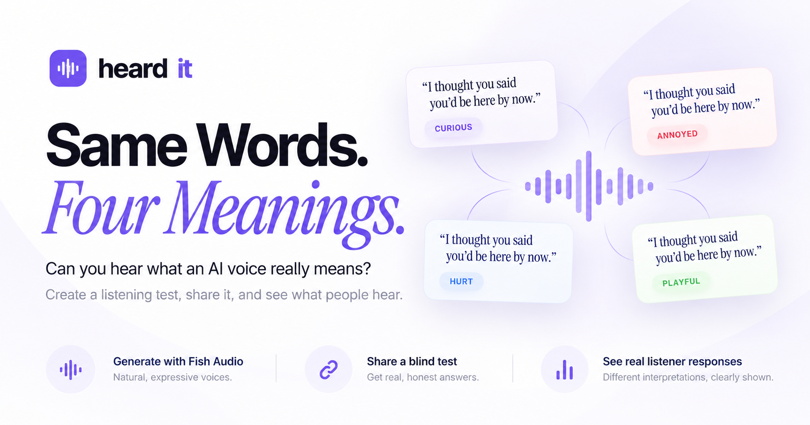
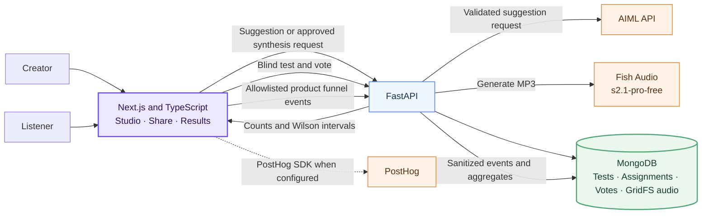

<p align="center">
  
</p>

<p align="center">
  <a href="https://nextjs.org/"></a>
  <a href="https://www.typescriptlang.org/"></a>
  <a href="https://fastapi.tiangolo.com/"></a>
  <a href="https://www.mongodb.com/"></a>
  <a href="https://fish.audio/"></a>
  <a href="https://aimlapi.com/"></a>
  <a href="https://vercel.com/analytics"></a>
  <a href="LICENSE"></a>
</p>

<p align="center">
  
</p>

<h1 align="center">Same words. Four meanings.</h1>

<p align="center">HeardIt explores what people hear in an AI voice—and whether hearing the delivery changes how they interpret the words.</p>

<p align="center">
  <a href="#how-it-works">How it works</a> · <a href="#architecture">Architecture</a> · <a href="#run-locally">Run locally</a> · <a href="#configuration">Configuration</a>
</p>

## The product

A creator writes one short sentence, chooses the meaning they intend, and supplies three plausible alternatives. HeardIt can ask AIML for editable suggestions, then sends the creator-approved direction to Fish Audio to synthesize an MP3.

Listeners open a share link and are randomly assigned to one of two groups: hear the generated voice or read the exact sentence. They choose the interpretation that fits. Results show each group's answers, intended-label selection rates, Wilson confidence intervals, and the observed difference between groups.

HeardIt measures interpretation in a small randomized sample. It does not measure voice quality or make population-wide claims.

The landing page can show MongoDB-backed, product-wide counts for saved listener responses and tests with at least one response. These counts are cached for up to five minutes and do not expose sentence text, intended labels, or individual assignments.

## How it works

1. **Create:** Write a sentence and confirm four distinct interpretations.
2. **Generate:** Review the inline voice direction and generate real Fish Audio speech.
3. **Share:** Publish the test only after audio has been saved.
4. **Listen and vote:** Each participant gets a stable audio or text assignment and one response.
5. **Learn:** Review persisted answers, sample sizes, uncertainty, and exploratory voice lift.

## Architecture



The Next.js app proxies API requests to FastAPI. Provider credentials stay on the server. MongoDB stores tests, stable participant assignments, deduplicated votes, generated audio in GridFS, and a limited set of sanitized product events. The frontend API client is typed from FastAPI's OpenAPI schema. Vercel Web Analytics records site page views when enabled for the Vercel project. When configured, the PostHog SDK receives the same allowlisted product events; automatic capture and session recording are disabled.

## Product safeguards

- The blind-test response does not disclose the intended meaning or voice direction before a vote.
- Audio and text groups receive the same sentence and answer choices.
- A unique test/participant key prevents ordinary repeat votes from the same browser identifier; it is not identity verification.
- Assignment tokens bind the test, participant hash, condition and issue time with an HMAC. Public test reads and votes verify the signature and the persisted assignment. Tokens cannot move a participant between conditions or bypass the unique vote index.
- Mongo-backed per-IP and per-test write limits and daily publishing/voting caps constrain bursts. Rotating browser IDs, clearing storage, VPNs and distributed clients can still create additional participants. These controls are basic abuse prevention, not proof of unique humans.
- Forwarded IP headers are ignored unless `HEARDIT_TRUST_PROXY=true`. Enable that setting only behind a controlled proxy that overwrites client-supplied forwarding headers; keep the backend inaccessible through an untrusted forwarding path. An optional CAPTCHA hook is disabled by default.
- Creators opening their own listener link see a labelled, read-only preview; it does not create a listener assignment or submit a vote.
- Results are calculated in Python. Empty groups show insufficient data, and results under 20 total responses are marked preliminary.
- Positive voice lift is presented as a sample difference, not proof of statistical significance or general model quality.
- Fish audio is cached by synthesis inputs. The landing demo stays in setup state until a genuine sample MP3 is configured.
- Product events exclude sentence text, voice directions, selected labels, participant IDs, management tokens, and assignment tokens. MongoDB retains events for up to 180 days; PostHog is optional and its project retention follows the configured account.
- The private `/admin` metrics page is unavailable unless `ADMIN_KEY` is set on both Next.js and FastAPI. Access uses an HTTP-only, one-hour signed session cookie; the backend also verifies the key on each private metrics request.
- After publishing, the creator can copy a private results recovery link once. Its management capability is in the URL fragment, which is not sent in the HTTP request; opening the link stores the capability in that browser and removes the fragment before analytics or API calls.

## Run locally

### Requirements

- Node.js 20 or newer and npm
- Python 3.11 or newer and `uv`
- MongoDB locally or MongoDB Atlas

### Start the app

1. Copy `.env.example` to `.env` and set the values in [Configuration](#configuration). Keep real credentials out of Git.
2. Start MongoDB locally, or use your Atlas connection string. To start the included local database with Docker:

   ```powershell
   docker compose up -d mongo
   ```

3. Start the API and web app in separate terminals from the repository root:

   ```powershell
   npm run api
   npm run dev
   ```

4. Open `http://localhost:3000`. Create a test, generate audio, publish it, then open its listener link in another browser or profile to submit a response.

## Configuration

The FastAPI server reads private provider and database credentials. Never use `NEXT_PUBLIC_` for Fish, AIML, or MongoDB secrets.

| Variable | Used by | Purpose |
| --- | --- | --- |
| `MONGODB_URI` | FastAPI | MongoDB connection string. |
| `MONGODB_DATABASE` | FastAPI | Database name, for example `heardit`. |
| `FISH_API_KEY` | FastAPI | Fish Audio speech synthesis. |
| `FISH_TTS_MODEL` | FastAPI | `s2.1-pro-free`. |
| `AIML_API_KEY` | FastAPI | Optional interpretation suggestions. |
| `AIML_MODEL` | FastAPI | AIML model available to your account. |
| `ADMIN_KEY` | Next.js and FastAPI | Optional matching random key of at least 32 characters for the private admin page and metrics endpoint. Leave unset to disable `/admin`. |
| `HEARDIT_ALLOWED_ORIGINS` | FastAPI | Comma-separated allowed frontend origins. |
| `API_INTERNAL_URL` | Next.js server | FastAPI base URL; local default is `http://127.0.0.1:8000`. |
| `NEXT_PUBLIC_APP_URL` | Next.js | Public site origin used for canonical metadata and share links. |
| `NEXT_PUBLIC_POSTHOG_KEY` | Browser | Optional PostHog project key. |
| `NEXT_PUBLIC_POSTHOG_HOST` | Browser | Optional PostHog host. |

See `.env.example` for a complete template. `ADMIN_KEY` must be the same value on the frontend and backend, and should be generated as a random value with at least 32 characters.

### Demo clips

With a real `FISH_API_KEY` in your environment or repository `.env`, generate four real Fish Audio MP3s directly from Fish Audio:

```powershell
uv run --directory apps/api python ../../scripts/seed-demo.py
```

The command writes `public/demo/{curious,annoyed,hurt,playful}.mp3` and `public/demo/manifest.json`. It does not need MongoDB or a running API. Review the generated clips, then commit the MP3s and manifest. The landing server component validates the manifest and local MP3 files at build/render time, and the browser plays those static files directly. If the files are absent, development shows a setup note and production does not claim that samples are ready.

### Private product metrics

Set the same `ADMIN_KEY` in the Vercel frontend project and the FastAPI deployment. Visit `/admin`, enter the key once, and the page reads test, response, vote, and funnel counts from MongoDB. It does not use PostHog as its source of truth. With the key unset, `/admin` returns a not-found page.

The tracked funnel is `create_started → voice_generation_completed → test_published → share_clicked → test_opened → vote_submitted`. Product events are filtered in the browser and again in FastAPI; neither store receives sentence text, voice directions, tokens, participant identifiers, or answer labels.

Vercel Analytics does not need an environment variable. Enable **Analytics** in the Vercel project's dashboard and redeploy to start collecting page views.

## API

FastAPI exposes `/health` and these `/api/v1` operations:

- `POST /suggestions` — validate AIML-generated interpretations and voice direction.
- `POST /audio/generate`, `GET /audio/{id}` — synthesize and retrieve cached MP3 assets.
- `POST /tests`, `GET /tests/{id}/public` — publish and return blind-safe test data.
- `POST /tests/{id}/assignment`, `POST /tests/{id}/votes` — assign conditions and persist responses.
- `GET /tests/{id}/results` — return creator-authorized experiment statistics.
- `GET /stats/public` — return product-wide counts without test content or labels.
- `POST /events` — store allowlisted funnel events with only bounded, non-content properties.
- `GET /admin/stats` — return MongoDB-backed metrics; requires `X-Admin-Key` and is disabled unless `ADMIN_KEY` is configured.

Creator-only endpoints require the management capability. TypeScript API definitions are generated from `apps/api/openapi.json` into `src/lib/api-schema.ts`:

```powershell
npm run api:types
```

## Checks

```powershell
npm run api:test
npm run test:analytics
npm run api:types
npm run typecheck
npm run lint
npm run build
npm run test:e2e
```

The E2E suite mocks API responses; it does not replace a live MongoDB and provider smoke test. Install the Playwright browser with `npx playwright install chromium` when needed. To use a different free port, set `$env:PLAYWRIGHT_PORT` before running the suite.

The GitHub Actions schema-drift check regenerates `apps/api/openapi.json` and `src/lib/api-schema.ts` and fails if either generated file differs from the committed version.

### Opt-in live API smoke flow

`scripts/smoke.py` (also available through `sh scripts/smoke.sh`) exercises health, Fish-backed audio generation, saved MP3 range delivery, publish, randomized assignment, blind-safe public content, one vote, and creator-authorized results after a fresh request. Fish and MongoDB credentials stay configured on FastAPI; this script reads only the API origin from `.env` and never forwards or prints provider credentials. A successful run leaves one test and one vote in MongoDB. Audio generation may reuse a cached Fish clip, which the script reports.

The smoke flow is intentionally not part of CI. Set `HEARDIT_CONFIRM_LIVE_FISH=YES` only when you intend to create persistent data and request audio generation. `HEARDIT_API_URL` overrides the local default `http://127.0.0.1:8000`; use HTTPS for a remote API. The generated participant ID exercises the backend's stable-assignment path, but this API smoke check is not a second real browser profile or proof of unique human identity.

```powershell
$env:HEARDIT_CONFIRM_LIVE_FISH = "YES"
# Optional for a remote FastAPI deployment:
$env:HEARDIT_API_URL = "https://your-fastapi-host"
uv run --directory apps/api python ../../scripts/smoke.py
```

On macOS/Linux, run `HEARDIT_CONFIRM_LIVE_FISH=YES HEARDIT_API_URL=https://your-fastapi-host sh scripts/smoke.sh`. Do not put provider keys in these commands; configure them only on FastAPI.

## License

HeardIt is available under the [MIT License](LICENSE).

<p align="center"><strong>Built with ❤️ by Nikhil Raikwar using Fish Audio</strong></p>
