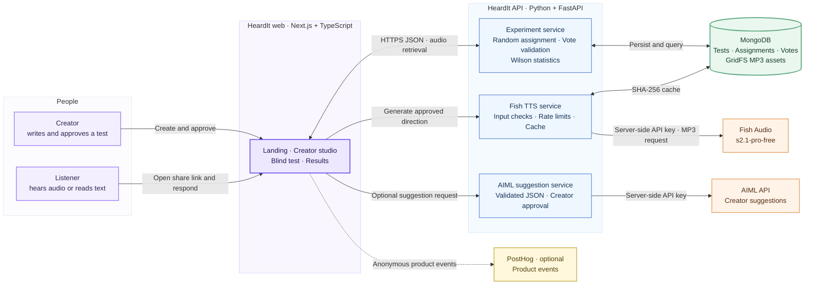

<p align="center">
  
</p>

<p align="center">
  
</p>

<p align="center">
  <a href="LICENSE"></a>
</p>

<h1 align="center">Same words. Four meanings.</h1>

<p align="center">An exploratory listening experiment built with Next.js, FastAPI, MongoDB, AIML and Fish Audio.</p>

<p align="center">
  <a href="#product">Product</a> · <a href="#architecture">Architecture</a> · <a href="#run-locally">Run locally</a> · <a href="#api-surface">API</a>
</p>

## Product

HeardIt asks a small, answerable question: when an AI voice speaks a sentence, do listeners recognize the meaning its creator intended? A visitor is assigned to hear the generated clip or read the exact same sentence, chooses one of four interpretations, then sees the intended answer. The creator can inspect persisted group results and uncertainty intervals.

The product uses Fish Audio for real synthesis. It never creates pretend audio or sample results. AIML suggestions are optional; a creator can edit every label and direction and must approve the direction by choosing to generate.

## Architecture



MongoDB persists experiments, assignments, votes, and MP3 assets in GridFS. Provider credentials stay in FastAPI; listeners receive only the information needed for their assigned condition.

The provided `public/banner.png` is used as the Open Graph and Twitter large-image preview. The public landing page has canonical metadata and Organization, WebSite, SoftwareApplication, and FAQ structured data; `robots.txt`, `sitemap.xml`, and `/llms.txt` describe the public site. Private, personalized, and experimental pages are excluded from indexing.

## Product routes

| Route | What it does |
| --- | --- |
| `/` | HeardIt landing page with a real-audio demo only when an MP3 and its intended label are configured. |
| `/create` | Compact creator studio: sentence, four editable interpretations, optional AIML suggestions, Fish synthesis, preview, and publish. |
| `/created/[id]` | Creator's published-test confirmation and sharing link. |
| `/t/[id]` | Blind listener flow with stable anonymous assignment, randomized answer order, and audio or text condition. |
| `/r/[id]` | Private creator results, protected by the management capability saved in the publishing browser. |

## API surface

FastAPI serves these endpoints under `/api/v1` (unless noted):

| Endpoint | Purpose |
| --- | --- |
| `GET /health` | API and MongoDB readiness status. |
| `POST /suggestions` | Optional AIML-generated labels and Fish direction, validated server-side. |
| `POST /audio/generate` | Fish Audio `s2.1-pro-free` synthesis with a MongoDB-backed content cache. |
| `GET /audio/{id}` | Retrieve a persisted MP3. |
| `POST /tests` | Publish only when a matching saved audio asset exists; returns the private creator token once. |
| `GET /tests/{id}/creator` | Read private creator data with `X-Management-Token`. |
| `GET /tests/{id}/public` | Return only the assigned listener condition and the four choices. |
| `POST /tests/{id}/assignment` | Persist a stable random audio/text assignment for a browser participant ID. |
| `POST /tests/{id}/votes` | Persist one response per test and anonymous participant. |
| `GET /tests/{id}/results` | Compute condition counts, answer distributions, Wilson intervals and exploratory voice lift; requires the creator token. |

FastAPI's OpenAPI schema and the generated TypeScript API types live at `apps/api/openapi.json` and `src/lib/api-schema.ts`. Refresh them with `npm run api:types`.

## Run locally

Requirements: Node.js 20+, npm, Python 3.11+, `uv`, and a MongoDB instance. Docker is optional if you use MongoDB Atlas.

1. Copy `.env.example` to `.env` and fill in the values listed below. Keep the real `.env` files local.
2. Start MongoDB locally, or use an Atlas URI:

   ```powershell
   docker compose up -d mongo
   ```

3. In two terminals at the repository root, run the API and website:

   ```powershell
   npm run api
   npm run dev
   ```

4. Open `http://localhost:3000`. Create a sentence and four labels, generate a Fish MP3, publish it, then open the copied `/t/{id}` link in a second browser profile to record a listener response. Creator results are private to the publishing browser.

## Environment variables

### FastAPI server (private)

| Variable | Required | Notes |
| --- | --- | --- |
| `MONGODB_URI` | Yes | Local or Atlas MongoDB connection string. |
| `MONGODB_DATABASE` | Yes | Database name; the example uses `heardit`. |
| `FISH_API_KEY` | For synthesis | Fish Audio key. Keep server-side only. |
| `FISH_TTS_MODEL` | Yes | `s2.1-pro-free`; the backend rejects unsupported model values. |
| `AIML_API_KEY` | For suggestions | AIML API key. Suggestions fail gracefully so labels can be entered manually. |
| `AIML_MODEL` | For suggestions | Model ID enabled for the AIML account. The current local configuration is `gpt-4o-mini`. |
| `HEARDIT_ALLOWED_ORIGINS` | Yes in production | Comma-separated frontend origins allowed by FastAPI CORS. |
| `HEARDIT_ENV` | Recommended | Use `production` in the deployed API environment. |

### Next.js server and optional browser analytics

| Variable | Required | Notes |
| --- | --- | --- |
| `API_INTERNAL_URL` | Yes in production | HTTPS URL of the FastAPI deployment. Next.js proxies `/api/v1` and `/health` server-side. Local default is `http://127.0.0.1:8000`. |
| `NEXT_PUBLIC_APP_URL` | Yes in production | Public HTTPS frontend origin, used for canonical metadata, the sitemap, and share links. |
| `NEXT_PUBLIC_HEARDIT_DEMO_AUDIO_URL` | Optional | URL to a genuine sample MP3. Leave blank to show the honest demo setup state. |
| `NEXT_PUBLIC_HEARDIT_DEMO_INTENDED_LABEL` | Optional | Intended label for that genuine public demo clip. Configure both demo variables together. |
| `NEXT_PUBLIC_POSTHOG_KEY` | Optional | PostHog project ingest key; safe for browser use. Never put provider or database credentials here. |
| `NEXT_PUBLIC_POSTHOG_HOST` | Optional | PostHog host; defaults to `https://us.i.posthog.com`. |

No Fish, AIML, or Mongo credentials are embedded in the Next.js bundle. The sample environment file contains placeholders only.

## Experiment and security notes

- Condition assignment and answer-option order are randomized server-side. A participant gets the same condition on refresh.
- The unique `(test_id, participant_hash)` indexes prevent ordinary duplicate assignments and votes. This is basic browser-level duplicate prevention, not proof of unique human identity.
- Public pre-vote responses omit the intended label and Fish direction. Creator results and creator-only test data require an unguessable management token; only its hash is stored in MongoDB.
- Result statistics are calculated in Python. Wilson 95% intervals show uncertainty, no-vote groups show insufficient data, and tests with fewer than 20 responses are marked preliminary. Voice lift is the observed difference in this randomized sample, not evidence of universal voice quality or statistical significance.
- Anonymous participant IDs and creator capability tokens are stored in the browser's local storage. Avoid XSS and do not share creator results URLs or access from an untrusted device.
- Audio is saved in MongoDB GridFS. MongoDB's 16 MB document limit does not apply to GridFS chunks; HeardIt enforces a 4 MB application limit to keep MP3 responses bounded.
- Generation and suggestion endpoints have server-side per-IP rate limits backed by MongoDB. Reverse-proxy deployments should be smoke-tested to confirm client IP handling and quotas under the chosen platform.
- PostHog is optional and receives product events, not API keys or sentence content. The main product metric is published tests with at least one submitted listener response.
- Dependency review: `npm audit --omit=dev --audit-level=high` reports zero production vulnerabilities. The full audit currently reports the high-severity `braces` advisory through the development-only Next.js ESLint dependency chain; npm offers no non-breaking fix, and `npm audit fix --force` would downgrade the Next lint configuration to v14. See the [braces advisory](https://github.com/advisories/GHSA-vfj7-8cjw-p6xm). Recheck it when the upstream toolchain publishes a patched dependency.

## Checks and live integration evidence

The current local environment has been used for an authenticated AIML suggestion, Fish Audio MP3 generation with `s2.1-pro-free`, MongoDB persistence, test publication, blind assignment, vote persistence, duplicate rejection, and creator-authorized results. Smoke-test records were removed afterward. This confirms a local integration path only; it is not a deployment claim. AIML was configured as `gpt-4o-mini` for that check. The social preview uses `public/banner.png` (1731 × 909); the landing page includes search and assistant-friendly metadata, structured FAQs, a crawlable sitemap, and a concise `/llms.txt` product summary.

Backend tests (11/11), TypeScript checks, lint and the production frontend build have passed in this workspace. Lint reports two existing warnings in `src/components/ui/floating-panel.tsx` and `src/components/ui/iphone.tsx`. The Playwright run did not complete: its default port 3101 was occupied, and the browser runtime is not installed in this environment. The runner now accepts `PLAYWRIGHT_PORT` so it can use a free port. No deployment has been made, so public HTTPS share links are not live yet.

Useful commands:

```powershell
npm run api:test
npm run typecheck
npm run lint
npm run build
npm run api:types
npm run test:e2e
```

Playwright E2E tests mock API responses and start the Next.js app themselves; they do not need MongoDB or provider credentials. Install the matching browser with `npx playwright install chromium` if it is not already present. If the default port is busy, choose another free port (PowerShell):

```powershell
$env:PLAYWRIGHT_PORT = "3197"
npx playwright test
```

These mocked browser tests do not substitute for the live provider/database smoke path described above.

Licensed under the [MIT License](LICENSE).

<p align="center">
  <a href="https://fish.audio/" title="Fish Audio"></a>
  <br />
  <strong>Built with ❤️ by Nikhil Raikwar using Fish Audio</strong>
</p>
